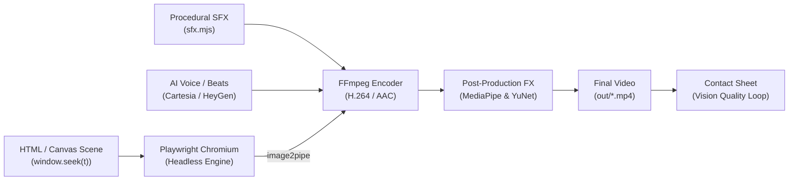

<div align="center">

# Antigravity Motion Studio

**High-Performance Programmatic Motion Design & Deterministic Video Engine**

[](https://github.com/inyogeshwar/antigravity-motion-graphics/actions/workflows/ci.yml)
[](https://github.com/inyogeshwar/antigravity-motion-graphics/actions/workflows/codeql.yml)
[](LICENSE)
[](package.json)
[](beats.py)

*Turn code into cinematic, broadcast-grade motion graphics, UI showreels, and talking-head visual effects with zero non-determinism.*

[Key Features](#key-features) •
[Architecture](#architecture) •
[Quickstart](#quickstart) •
[The Render Contract](#the-render-contract) •
[Documentation](#documentation) •
[Contributing](#contributing)

</div>

---

## Overview

**Antigravity Motion Studio** is an open-source, code-driven video synthesis studio designed for engineers and motion designers. It bridges the gap between web technologies (HTML5, Canvas, WebGL, React, GSAP) and broadcast video production by enforcing a strict mathematical **Render Contract**:

$$\text{Frame State} = f(t)$$

Every animation is a pure, closed-form function of time $t$. By replacing wall-clock transitions and non-deterministic event loops with analytical harmonic spring equations and seeded pseudo-randomness, renders are **bit-identical**, parallelizable, and capable of rendering frame 1,000 in $O(1)$ constant time without simulating prior frames.

---

## Key Features

- **Deterministic Closed-Form Springs (`lib/motion.js`):** Analytical damped oscillator physics (`spring(t, k, d)`) and continuous target tracking (`track(t, keys)`).
- **Zero-Dependency Headless Renderer (`render.mjs`):** High-speed Playwright Chromium automation piping raw frames into FFmpeg with sub-frame motion blur sampling.
- **Procedural Sound Synthesizer (`sfx.mjs`):** Pure algorithmic sound design generating clicks, pops, thumps, whooshes, and dings directly into 16-bit 48kHz WAV audio buffers.
- **AI Voice Narration (`cartesia.mjs` & `heygen.mjs`):** Seamless integration with Cartesia AI (`sonic-3.6`) and HeyGen Voice Turbo Free for multilingual product promotion.
- **Behind-the-Head & Face Tracking Effects (`.agent/skills/effects`):** 51 computer-vision effects placing 3D typography, liquid glass widgets, and dynamic brackets around live human video.
- **Beat Grid Synchronization (`beats.py`):** Onset detection and perceptual beat alignment locking animation milestones to the audio rhythm.
- **Vision Verification Loop:** Automated FFmpeg contact sheet generation for visual inspection and scoring before publication.

---

## Architecture



---

## Quickstart

### Option A: One-Click Scaffold via NPX (Recommended)

Just like `npx create-remotion` or `npx create-next-app`, you can scaffold a new deterministic motion studio project in one command:

```bash
# Interactive scaffolding wizard
npx antigravity-motion-graphics my-video

# Or using the create- alias:
npx create-antigravity-motion my-video

# Non-interactive quickstart (Canvas template + auto-install):
npx antigravity-motion-graphics my-video --template canvas --yes --install
```

### Option B: Clone & Run Locally

```bash
git clone https://github.com/inyogeshwar/antigravity-motion-graphics.git
cd antigravity-motion-graphics
npm install
npx playwright install chromium
```

### 2. Configure Environment (Optional)
```bash
cp .env.example .env
# Add CARTESIA_API_KEY or HEYGEN_API_KEY if using AI voice generation
```

### 3. Run Automated Tests
```bash
npm run test:all
```

### 4. Render a Deterministic Video
```bash
# Render 15-second composition to MP4
npm run render -- --dur 15 --fps 30 --w 1080 --h 1920 --out out/silent.mp4
```

### 5. Generate Procedural Sound Effects
```bash
# Synthesize audio cues to 48kHz WAV
npm run sfx cues.json out/sfx.wav
```

---

## Project Structure

```
antigravity-motion-graphics/
├── .github/
│   ├── ISSUE_TEMPLATE/        # Structured Bug and Feature request forms
│   ├── workflows/             # GitHub Actions CI and CodeQL security workflows
│   ├── CODEOWNERS             # Repository maintainer definitions
│   ├── dependabot.yml         # Automated weekly dependency updates
│   ├── PULL_REQUEST_TEMPLATE.md
│   └── copilot-instructions.md # Coding agent standards and Render Contract rules
├── docs/                      # Architectural and engine documentation
│   ├── architecture.md        # Complete multi-engine studio design
│   ├── render-contract.md     # Pure time mathematics & anti-slop rules
│   ├── voice-engines.md       # Cartesia & HeyGen TTS integration guide
│   └── effects-pipeline.md    # Face tracking and 51 video effects guide
├── lib/
│   └── motion.js              # Closed-form springs, PRNG, and tracker physics
├── tests/                     # Test suites (Node.js test runner & Python unittest)
│   ├── motion.test.js         # Spring dynamics & PRNG tests
│   ├── sfx.test.js            # Audio synthesis & WAV header tests
│   ├── api.test.js            # TTS presets & fallback tests
│   └── test_beats.py          # Beat grid generator tests
├── assets/                    # Project source media and branding
├── out/                       # Rendered video outputs and contact sheets (gitignored)
├── beats.py                   # Audio onset & beat tracking utility
├── cartesia.mjs               # Cartesia sonic-3.6 multilingual TTS client
├── cues.json                  # Sample sound design cue triggers
├── heygen.mjs                 # HeyGen Voice Turbo Free TTS client
├── index.html                 # Deterministic canvas motion graphic composition
├── render.mjs                 # Playwright frame-by-frame renderer
├── sfx.mjs                    # Procedural sound design engine
├── AGENTS.md                  # Comprehensive AI agent operational playbook
├── CHANGELOG.md               # Version history and milestone log
├── CONTRIBUTING.md            # Guidelines for open-source contributors
├── CODE_OF_CONDUCT.md         # Contributor Covenant v2.1
├── SECURITY.md                # Responsible vulnerability disclosure policy
├── LICENSE                    # MIT License
└── package.json               # Package configuration, dependencies, and scripts
```

---

## The Render Contract

When authoring or contributing animations, you must adhere to the **Render Contract**:

1. **Pure Function of Time:** All animations must implement `window.seek(t)`, taking time $t$ in seconds and deterministically positioning all visual elements.
2. **Zero Carried State:** Avoid `setTimeout`, `setInterval`, or CSS transitions.
3. **Seeded Randomness Only:** Never use `Math.random()`. Use `rng(seed)` from `lib/motion.js` for bit-identical reproducibility.
4. **Analytical Spring Physics:** Use `spring(t, k, d)` instead of cubic-bezier easing to ensure physical realism, momentum, and mass.

```javascript
import { spring, track, rng } from './lib/motion.js';

// Calculate position at t=0.42s in O(1) time
const scale = 1 + 0.2 * spring(t, 180, 24);
```

For complete mathematical derivations, see [The Render Contract](docs/render-contract.md).

---

## Vision Verification & Quality Scoring

To guarantee production quality, run the automated contact sheet verification command before delivery:

```bash
ffmpeg -i out/video.mp4 -vf "fps=2,scale=270:-1,tile=6x5" -frames:v 1 out/contact.png
```

Inspect `out/contact.png` against our studio benchmark (target score: 8+/10):
- **Hook (0-2s):** Strong visual arrival in the first 2 seconds.
- **Mobile Readability:** Legible typography and contrast on small viewports.
- **Motion Dynamics:** Fluid spring dynamics with zero dead frames.
- **Pacing:** New visual milestones occurring every 2 to 4 seconds.
- **Audio Alignment:** Visual impacts locked to sound cues and beat grid.

---

## Contributing

We welcome contributions! Please see [CONTRIBUTING.md](CONTRIBUTING.md) for local development instructions, commit standards, and pull request workflows.

---

## Security

Please report vulnerabilities privately via our [Security Policy](SECURITY.md). Never commit `.env` files or API credentials to the repository.

---

## License

This project is licensed under the [MIT License](LICENSE).
