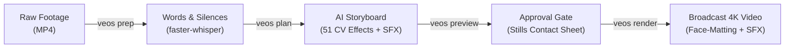
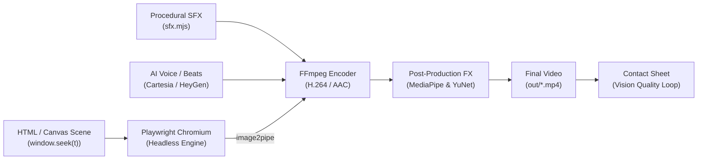

<div align="center">

# MotionOS (Antigravity Edition)

**The Autonomous Operating System for Motion Design & Vibe Editing**

[](https://www.npmjs.com/package/antigravity-motion-graphics)
[](https://github.com/inyogeshwar/antigravity-motion-graphics/actions/workflows/ci.yml)
[](https://github.com/inyogeshwar/antigravity-motion-graphics/actions/workflows/codeql.yml)
[](LICENSE)
[](package.json)
[](beats.py)

*Turn raw footage into viral creator videos and write code for cinematic, broadcast-grade motion graphics with zero non-determinism.*

[Vibe Editing](#vibe-editing-workflow) •
[Key Features](#key-features) •
[Quickstart](#quickstart) •
[Documentation Guide](docs/MOTIONOS_GUIDE.md) •
[The Render Contract](#the-render-contract)

</div>

---

## Overview

**MotionOS** is an open-source, code-driven video synthesis and editing operating system. It unifies two world-class paradigms:
1. **The MotionOS Vibe Editing:** Automated talking-head video editing that transcribes raw footage, cuts pauses, applies 51 computer-vision effects behind the speaker's head, and generates storyboard previews for creator approval.
2. **The 0xMovez Deterministic Motion Engine:** High-performance mathematical motion graphics where every frame is a pure function of time:

$$\text{Frame State} = \text{window.seek}(t)$$

---

## MotionOS Vibe Editing Workflow

MotionOS provides a 4-step automated pipeline inspired by the VEOS workflow:



```bash
# 1. Prep speech & detect silences
npx motionos vibe prep "raw.mp4"

# 2. Plan storyboard with style preset (tech-bento, bold-creator, minimal, neon-glow)
npx motionos vibe plan "raw.mp4" --style tech-bento

# 3. Fast preview gate (review still frames before rendering)
npx motionos vibe preview "raw.mp4"

# 4. Render broadcast video with face matting & SFX
npx motionos vibe render "raw.mp4" --out "out/final.mp4"
```

Read the full [MotionOS Guide & Production Manual](docs/MOTIONOS_GUIDE.md).

---

## Key Features

- **Deterministic Closed-Form Springs (`lib/motion.js`):** Analytical damped oscillator physics (`spring(t, k, d)`) and continuous target tracking (`track(t, keys)`).
- **Zero-Dependency Headless Renderer (`render.mjs`):** High-speed Playwright Chromium automation piping raw frames into FFmpeg with sub-frame motion blur sampling.
- **Procedural Sound Synthesizer (`sfx.mjs`):** Pure algorithmic sound design generating clicks, pops, thumps, whooshes, and dings directly into 16-bit 48kHz WAV audio buffers.
- **AI Voice Narration (`cartesia.mjs` & `heygen.mjs`):** Seamless integration with Cartesia AI (`sonic-3.6`) and HeyGen Voice Turbo Free for multilingual product promotion.
- **Behind-the-Head & Face Tracking Effects (`.agent/skills/effects`):** 51 computer-vision effects placing 3D typography, liquid glass widgets, and dynamic brackets around live human video.
- **Beat Grid Synchronization (`beats.py`):** Onset detection and perceptual beat alignment locking animation milestones to the audio rhythm.
- **Vision Verification Loop:** Automated FFmpeg contact sheet generation for visual inspection and scoring before publication.

---

## Architecture



---

## Quickstart

### Option A: One-Click Scaffold via NPX (Recommended)

Just like `npx create-remotion` or `npx create-next-app`, you can scaffold a new deterministic motion studio project in one command:

```bash
# Interactive scaffolding wizard
npx antigravity-motion-graphics my-video

# Or using the create- alias:
npx create-antigravity-motion my-video

# Non-interactive quickstart (Canvas template + auto-install):
npx antigravity-motion-graphics my-video --template canvas --yes --install
```

### Option B: Clone & Run Locally

```bash
git clone https://github.com/inyogeshwar/antigravity-motion-graphics.git
cd antigravity-motion-graphics
npm install
npx playwright install chromium
```

### 2. Configure Environment (Optional)
```bash
cp .env.example .env
# Add CARTESIA_API_KEY or HEYGEN_API_KEY if using AI voice generation
```

### 3. Run Automated Tests
```bash
npm run test:all
```

### 4. Render a Deterministic Video
```bash
# Render 15-second composition to MP4
npm run render -- --dur 15 --fps 30 --w 1080 --h 1920 --out out/silent.mp4
```

### 5. Generate Procedural Sound Effects
```bash
# Synthesize audio cues to 48kHz WAV
npm run sfx cues.json out/sfx.wav
```

### 6. Kinetic Typography & Auto-Caption Reel Showcase
```bash
# Render the official MotionOS 9:16 vertical typography reel (1080x1920)
node render.mjs --html compositions/motionos_reel/index.html --out out/motionos_typography_silent.mp4 --dur 12 --fps 30

# Mux with Cartesia voice narration & creator SFX
ffmpeg -y -i out/motionos_typography_silent.mp4 -i scratch/motionos_reel_audio.m4a -c:v copy -c:a aac out/motionos_typography_reel.mp4
```

---

---

## 🎬 Showcase Catalog & Creator Style Gallery

MotionOS includes battle-tested, high-retention template compositions reproducing the exact editing archetypes of top viral creators:

### 1. Advoc Media Suite (`aiwith.om` / Claude Code Pipeline)

| Style Preset | Inspiration & Source | Visual Look & Palette | Key Components | Render Command |
|---|---|---|---|---|
| **`advoc-cream-pipeline`** *(Style 1A)* | `@aiwith.om`<br>[`morluto/rea`](https://github.com/morluto/rea) | Warm Paper/Cream (`#F3ECE1`) + Hot Pink (`#FF2D95`) + Dark Ink | Floating macOS windows, terminal prompt, 4-step progress stepper, rubber stamps. | `node render.mjs --html compositions/rea_showcase/index.html --dur 26.2 --fps 30` |
| **`neurobyte-cosmic-glass`** *(Style 1B)* | `@neurobyte96`<br>`Video-28898` | Dark Cosmic Navy (`#0B111E`) + Electric Cyan (`#00D2FF`) Glow | Frosted glassmorphism cards, GitHub star counts, 10-app grid finale. | `npx antigravity-motion vibe plan clip.mp4 --style neurobyte-cosmic-glass` |
| **`advoc-split-talking-head`** *(Style 1C)* | `@aiwith.om`<br>`Video-58518` | 50/50 Split Canvas (Cream Paper Top + Creator Face Bottom) | Animated folder morph, HyperFrames code card, lavalier talking-head. | `npx antigravity-motion vibe plan clip.mp4 --style advoc-split-talking-head` |
| **`advoc-connector-automation`** *(Style 1D)* | `@aiwith.om`<br>`Video-68340` | Cream Canvas + Floating Dark UI Windows | Dotted connector lines (Instagram ➔ Claude), real-time profile analytics. | `npx antigravity-motion vibe plan clip.mp4 --style advoc-connector-automation` |

---

### 2. Raj Shamani High-Retention Podcast Suite

| Style Preset | Video Reference | Caption Style & Typography | Color Highlights & VFX | B-Roll & Visual Features |
|---|---|---|---|---|
| **`raj-shamani-neon-lime`** | `Video-59491` | Ultra-Bold Sans (`TheBoldFont` / `Montserrat`) | White text + **Electric Lime Green (`#00FF66`)** Glow | Top header pill (`THIS MINDSET>>>>🔥⚡`), sudden punch-in zooms. |
| **`raj-shamani-cinema-serif`** | `Video-74558` | Elegant Serif (`Cinzel` / `Playfair Display`) | Pure Crisp White, clean bottom-center | **Movie B-Rolls** (Titanic, DiCaprio, Eternal Sunshine) synced to dialogue. |
| **`raj-shamani-crimson-hook`** | `Video-1840` *(Sam Altman)* | Geometric Heavy Sans | White + **Giant Crimson Red (`#FF1E27`)** Glow | Negative space curiosity hook (`So What Version... DIED?`), archival PIP. |
| **`raj-shamani-handwritten-story`** | `Video-19856` | Organic Handwritten (`Caveat` / `Indie Flower`) | Soft Minimalist White (1-2 words/line) | Casual intimate dialogue pacing, zero abrupt cuts. |
| **`raj-shamani-hype-emoji`** | `Video-51800` | Heavy Extended Sans | **Dual-Tone: Neon Yellow (`#FFE500`) + Red Glow (`#FF2222`)** | **3D Animated Emojis** (💀 Skull popping on punchlines), rapid jump cuts. |

*Template Composition:* `compositions/podcast_raj_shamani/index.html`  
*Render Command:* `node render.mjs --html compositions/podcast_raj_shamani/index.html --dur 30 --fps 30`

---

### 3. Bollywood & Lyrical Synchronized Suite (BitChord + SpotiDost)

| Style Preset | Inspiration | Typography & Animation | Features | Render Command |
|---|---|---|---|---|
| **`lyrical-neon-pulse`** | BitChord + SpotiDost *(Kamariya)* | Kinetic Bold Display + Pulsing Glow | Beat-locked word boundaries, Shazam audio recognition, LRCLIB sync. | `node render.mjs --html compositions/kamariya_reel/index.html --dur 25 --fps 30` |
| **`lyrical-minimal-editorial`** | BitChord Editorial | Modern Serif (`Billion Dreams` / `Lemon Milk`) | Film grain overlays, subtle drift, romantic Bollywood pacing. | `node scripts/auto_lyrics_syncer.mjs track.mp3 --preset minimal` |
| **`lyrical-cyber-hindi`** | Indian Hip-Hop & Indie Folk | Devanagari Calligraphic + Cyber Cyan Glow | Native Hindi script tracking, dynamic glow drop shadows. | `node scripts/auto_lyrics_syncer.mjs track.mp3 --preset cyber` |

---

### 4. Core MotionOS Studio Showreels

- **Mega 7-in-1 Template Reel:** `compositions/mega_template_reel/index.html` — Showcases UI morphs, kinetic springs, code blocks, emoji bursts, and finale.
- **MotionOS Typography Reel:** `compositions/motionos_reel/index.html` — Kinetic typography and sound design showcase.


### 5. You B Tech Faceless Tech Tutorial Suite (16:9 Landscape)

MotionOS includes a fully automated **Universal Dynamic Tutorial Generator** for the You B Tech faceless style. You can generate a 16:9 landscape tutorial video for **ANY arbitrary topic** (`cursor-ai`, `docker`, `supabase`, `nextjs`, `python`, etc.) with automatic Hindi voiceover, synced captions, procedural SFX, spring animations, and 3D mockups in a single command:

```bash
# Generate video for any topic
npx motionos tutorial cursor-ai
npx motionos tutorial docker
npx motionos tutorial supabase
npx motionos tutorial "Next.js 15" out/nextjs_tutorial.mp4
```


| Style Preset | Inspiration & Source | Visual Look & Palette | Key Components | Render Command |
|---|---|---|---|---|
| **you-b-tech-faceless** | [You B Tech (@You_B_Tech)](https://www.youtube.com/@You_B_Tech/videos) | 16:9 Landscape, Ambient Soft Cream (#F8F9FD) + Blurred Purple Nebulae (#8B5CF6) | Central Agent node with curved SVG bezier pipelines, macOS roadmap checklist, 84% Donut progress ring, Local PC vs 24/7 Cloud cards, 3D laptop SaaS dashboard. | 
ode render.mjs --html compositions/you_b_tech_explainer/index.html --w 1920 --h 1080 --dur 26.1 --fps 30 |


## Project Structure

```
antigravity-motion-graphics/
├── .github/
│   ├── ISSUE_TEMPLATE/        # Structured Bug and Feature request forms
│   ├── workflows/             # GitHub Actions CI and CodeQL security workflows
│   ├── CODEOWNERS             # Repository maintainer definitions
│   ├── dependabot.yml         # Automated weekly dependency updates
│   ├── PULL_REQUEST_TEMPLATE.md
│   └── copilot-instructions.md # Coding agent standards and Render Contract rules
├── docs/                      # Architectural and engine documentation
│   ├── MOTIONOS_GUIDE.md      # Official MotionOS & VEOS workflow manual
│   ├── architecture.md        # Complete multi-engine studio design
│   ├── motion-studio-course.md # The 0xMovez Autonomous Motion Studio Masterclass
│   ├── render-contract.md     # Pure time mathematics & anti-slop rules
│   ├── voice-engines.md       # Cartesia & HeyGen TTS integration guide
│   └── effects-pipeline.md    # Face tracking and 51 video effects guide
├── lib/
│   ├── motion.js              # Closed-form springs, PRNG, and tracker physics
│   └── veos.js                # MotionOS Vibe Editing OS engine & style presets
├── bin/
│   ├── cli.js                 # Unified 'motionos' CLI entry point
│   ├── veos.js                # VEOS sub-command runner (prep, plan, preview, render)
│   └── create.js              # Interactive & non-interactive project scaffolder
├── tests/                     # Test suites (Node.js test runner & Python unittest)
│   ├── motion.test.js         # Spring dynamics & PRNG tests
│   ├── sfx.test.js            # Audio synthesis & WAV header tests
│   ├── api.test.js            # TTS presets & fallback tests
│   └── test_beats.py          # Beat grid generator tests
├── assets/                    # Project source media and branding
├── out/                       # Rendered video outputs and contact sheets (gitignored)
├── beats.py                   # Audio onset & beat tracking utility
├── cartesia.mjs               # Cartesia sonic-3.6 multilingual TTS client
├── cues.json                  # Sample sound design cue triggers
├── heygen.mjs                 # HeyGen Voice Turbo Free TTS client
├── index.html                 # Deterministic canvas motion graphic composition
├── render.mjs                 # Playwright frame-by-frame renderer
├── sfx.mjs                    # Procedural sound design engine
├── AGENTS.md                  # Comprehensive AI agent operational playbook
├── CHANGELOG.md               # Version history and milestone log
├── CONTRIBUTING.md            # Guidelines for open-source contributors
├── CODE_OF_CONDUCT.md         # Contributor Covenant v2.1
├── SECURITY.md                # Responsible vulnerability disclosure policy
├── LICENSE                    # MIT License
└── package.json               # Package configuration, dependencies, and scripts
```

---

## The Render Contract

When authoring or contributing animations, you must adhere to the **Render Contract**:

1. **Pure Function of Time:** All animations must implement `window.seek(t)`, taking time $t$ in seconds and deterministically positioning all visual elements.
2. **Zero Carried State:** Avoid `setTimeout`, `setInterval`, or CSS transitions.
3. **Seeded Randomness Only:** Never use `Math.random()`. Use `rng(seed)` from `lib/motion.js` for bit-identical reproducibility.
4. **Analytical Spring Physics:** Use `spring(t, k, d)` instead of cubic-bezier easing to ensure physical realism, momentum, and mass.

```javascript
import { spring, track, rng } from './lib/motion.js';

// Calculate position at t=0.42s in O(1) time
const scale = 1 + 0.2 * spring(t, 180, 24);
```

For complete mathematical derivations, see [The Render Contract](docs/render-contract.md).

---

## Vision Verification & Quality Scoring

To guarantee production quality, run the automated contact sheet verification command before delivery:

```bash
ffmpeg -i out/video.mp4 -vf "fps=2,scale=270:-1,tile=6x5" -frames:v 1 out/contact.png
```

Inspect `out/contact.png` against our studio benchmark (target score: 8+/10):
- **Hook (0-2s):** Strong visual arrival in the first 2 seconds.
- **Mobile Readability:** Legible typography and contrast on small viewports.
- **Motion Dynamics:** Fluid spring dynamics with zero dead frames.
- **Pacing:** New visual milestones occurring every 2 to 4 seconds.
- **Audio Alignment:** Visual impacts locked to sound cues and beat grid.

---

---

## 📱 Instagram Viral Intelligence Suite

Powered by the battle-tested heuristics from Jake Schincariol's Instagram Agent Suite, MotionOS includes 3 native viral intelligence tools to optimize your videos before rendering:

```bash
# 1. Score your video opening hook (0-100) before shooting or rendering
npx antigravity-motion hook "Nobody tells you that your first 30 reels will fail"

# 2. Strip invisible Unicode watermarks & 154 AI slop clichés from your script
npx antigravity-motion humanize script.txt --report

# 3. Lint your caption for the 125-char visible feed cutoff & Instagram's 5-hashtag cap
npx antigravity-motion caption caption.txt --keywords "freelance pricing,client contracts"
```

### The 5 Hook Heuristics:
1. **Length:** Spoken in under 3.0s (5–12 words).
2. **Specificity:** Concrete markers (dollars, percentages, exact numbers, named entities).
3. **Stakes:** Clear loss, failure, risk, cost, or tension marker.
4. **Frontload:** Payload delivered in the first 2 words (no greetings, no "Stop scrolling").
5. **Address:** Direct callout to the target viewer ("you", niche role).


## Contributing

We welcome contributions! Please see [CONTRIBUTING.md](CONTRIBUTING.md) for local development instructions, commit standards, and pull request workflows.

---

## Security

Please report vulnerabilities privately via our [Security Policy](SECURITY.md). Never commit `.env` files or API credentials to the repository.

---

## Acknowledgments & Credits

Special credit and gratitude to the open-source and creator communities whose work powers and inspires our lyrical synchronization and typography features:

- **[BitChord](https://github.com/kushagrasinghx/BitChord)** (by [kushagrasinghx](https://github.com/kushagrasinghx)): The brilliant open-source YouTube Music & audio player architecture that inspired our multi-provider synced lyrics and Apple-like typography tracking.
- **[LRCLIB](https://lrclib.net)**: The amazing open, free community REST API providing millisecond-accurate synchronized lyrics (`.lrc`) across regional, Bollywood, and international tracks without API keys.
- **[StuffByAbhi](https://stuffbyabhi.blogspot.com/2021/10/trending-top-20-lyrical-fonts-for-edits.html)**: For curated trending lyrical fonts inspiration (*American Captain, Billion Dreams, Charlotte Southern, Big Noodle, Lemon Milk, Cocogoose, Magista Brush, Wintersoul*).
- **Lyrics Ecosystem**: Credit to [PaxSenix](https://lyrics.paxsenix.org), [lrc.red](https://lrc.red), [BetterLyrics](https://github.com/better-lyrics/better-lyrics), [Megalobiz](https://www.megalobiz.com), [SimpMusic](https://github.com/maxrave-dev/SimpMusic), and [BiniLyrics](https://github.com/binimum).

---

## License

This project is licensed under the [MIT License](LICENSE).
