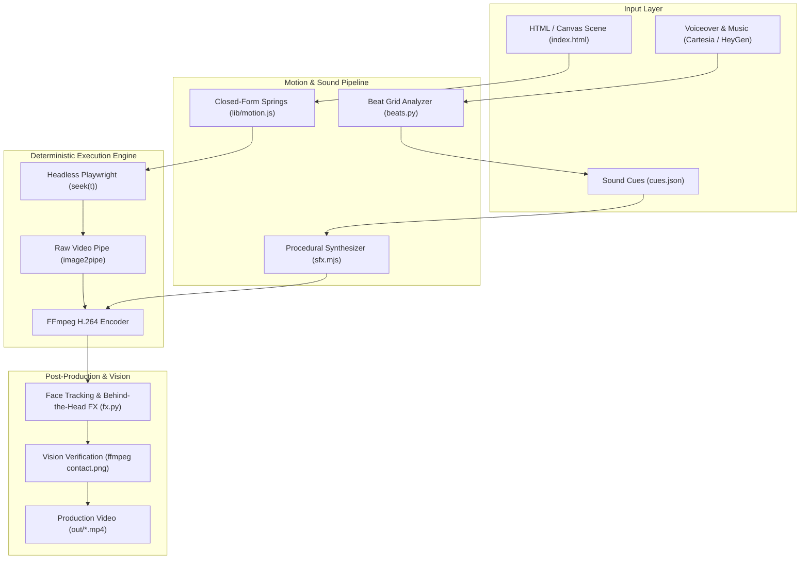

# Architecture Overview

**Antigravity Motion Studio** unifies three high-performance motion design engines into a cohesive pipeline powered by Google Antigravity:



---

## The Three Production Routes

### Route A: Zero-Dependency Raw Deterministic Canvas (`index.html` + `render.mjs`)
- **Technology:** Pure HTML5 / Canvas / SVG + `window.seek(t)` + Playwright Chromium + FFmpeg pipe.
- **Best For:** Ultra-fast renders, mathematical precision, interactive mockups, 100% deterministic outputs.
- **Workflow:**
  ```bash
  npm run render -- --dur 15 --fps 30 --w 1080 --h 1920
  ```

### Route B-1: Remotion React Framework (`remotion/`)
- **Technology:** React components, Remotion Player, Studio UI (`npx remotion studio`).
- **Best For:** Multi-composition projects, complex reusable components, dynamic templates.
- **Workflow:**
  ```bash
  npm run remotion:studio
  ```

### Route B-2: HyperFrames GSAP Pipeline (`hyperframes/`)
- **Technology:** GSAP timelines, web-page based motion graphics, HeyGen cloud MCP.
- **Best For:** High-tempo promotional films, GSAP plugin ecosystems, cloud-rendered avatars.

---

## Audio Pipeline

- **Procedural Synthesizer (`sfx.mjs`):** Generates algorithmic clicks, pops, thumps, and whooshes directly to 16-bit 48kHz PCM WAV buffers with zero external dependencies.
- **AI Voice Integration (`cartesia.mjs` & `heygen.mjs`):** Integrates Cartesia `sonic-3.6` (for expressive Hindi and English ads) and HeyGen Voice Turbo Free (for zero-cost high-scale narration).
- **Beat Grid Synchronization (`beats.py`):** Calculates beat timestamps and perceptual onset peaks so cuts and UI actions lock to rhythm.
