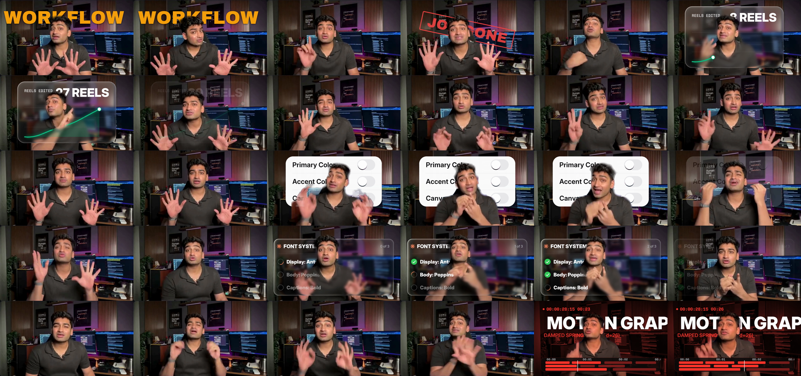
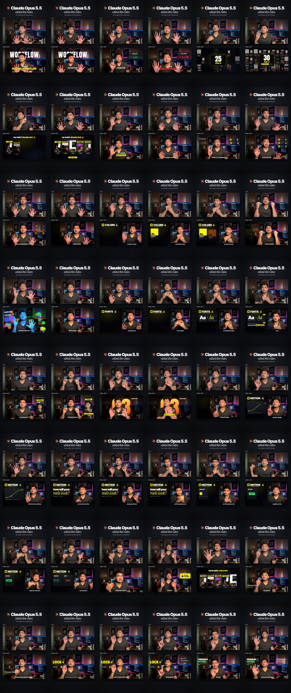

# Creator Infotainment Reel Showcase - MotionOS

This example demonstrates an automated, asset-driven video edit produced using **MotionOS** inside Google Antigravity.

---

## 📸 Render Outputs & Contact Sheets

### 1. MotionOS Render Preview


### 2. Reference Breakdown


---

## 🎬 Production Specs
- **Input Footage:** `raw_reel.mp4` (48.98s, 1080x1920 9:16 vertical video)
- **Transcription:** Local Faster-Whisper Large V3 Turbo (`showcase.words.json`)
- **Storyboard Plan:** `showcase_plan.json`
- **Active Creator Style:** `creator-infotainment-motion` (`templates/playbooks/_styles/creator-infotainment-motion/`)
- **Key Animation Techniques:**
  - Depth Sandwich (`text-behind-head` segmentation with MediaPipe Selfie Segmenter)
  - Bezier Easing Motion Specs
  - Split Cards (01 COLORS, 02 FONTS, 03 MOTION)
  - Instagram Comment CTA Box

---

## 🛠️ How to Reproduce

```bash
# 1. Transcribe footage locally with Whisper (offline)
python .agent/skills/effects/scripts/words.py examples/creator-showcase/raw_reel.mp4

# 2. Generate MotionOS plan
npx motionos vibe plan examples/creator-showcase/showcase.words.json --style creator-infotainment-motion

# 3. Render video deterministically
npx motionos vibe render examples/creator-showcase/showcase_plan.json --out out/showcase_render.mp4
```
